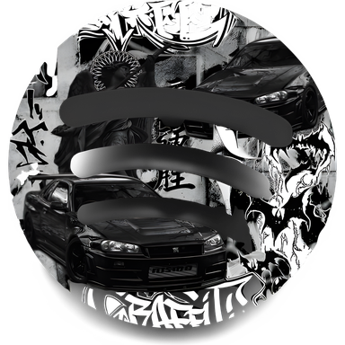
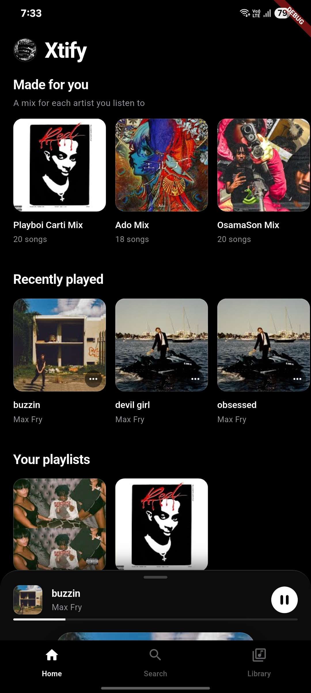
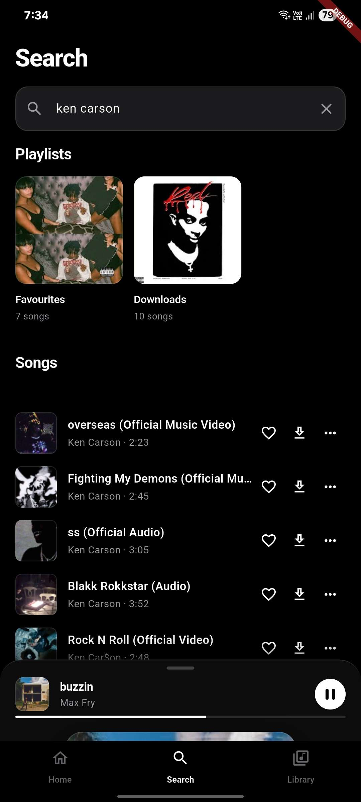
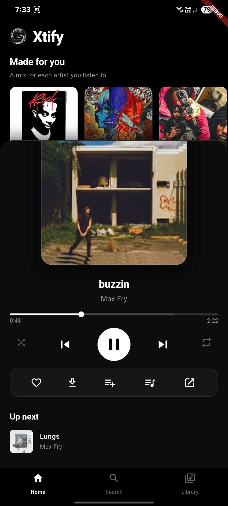
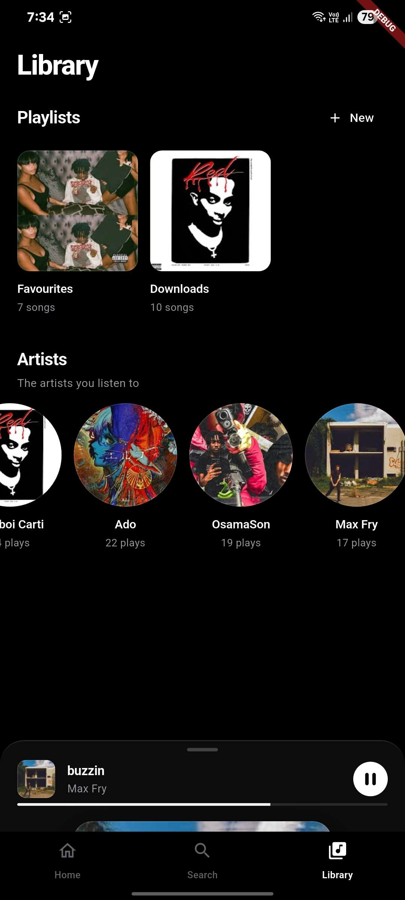
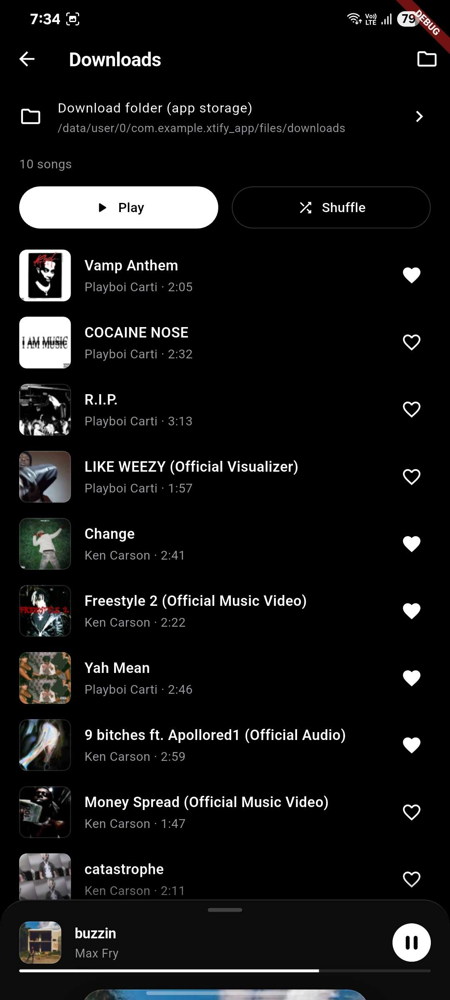
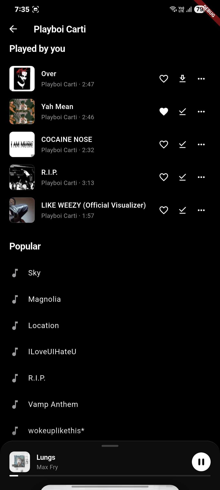
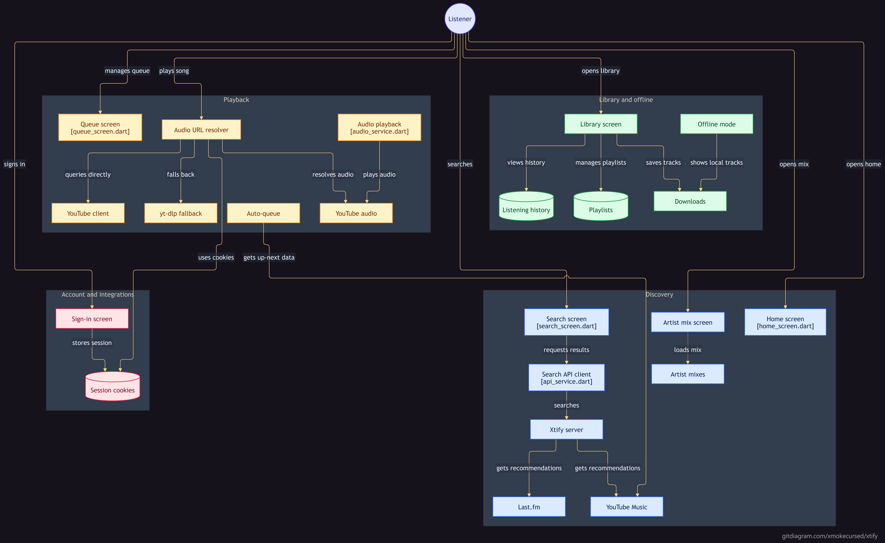

<div align="center">



# Xtify

**A clean, ad-free music player for Android. Search any song, play it, keep your favourites offline.**

[Download](../../releases/latest) · [Install](#install) · [How it works](#how-it-works)

</div>

---

## Screenshots

| Home | Search | Player |
| :---: | :---: | :---: |
|  |  |  |

| Library | Downloads | Playlist |
| :---: | :---: | :---: |
|  |  |  |

---

## Features

**Listen**
- Search songs and artists and play them. The first song after opening the app can take a bit longer to start.
- **Auto-queue:** when a song ends, Xtify picks the next one. Use the gear next to *Up next* to choose **similar songs** or **same artist only**.
- **Made for you:** a mix for each artist you listen to.
- Play next, add to queue, reorder, shuffle and repeat.
- Background play, with lock-screen and notification controls.
- Remembers the last song and where you stopped.
- Mostly Spotify/YTMusic premium experience.

**Keep**
- **Playlists and Favourites**, with modern sorting and a filtering options.
- **Downloads** with title, artist and cover art written into the file.
- **Offline mode:** with no internet, only your downloads show and play.
- History upto last 30 songs.

**Everyday**
- No ads.
- No subscription bs.
- Only songs.

---

## Install

1. Download `xtify.apk` from the [Releases page](../../releases/latest).
2. Open it on your phone and allow installs from your browser or file manager if asked.

Signing in to YouTube is optional (see below).

### Build it yourself

Needs [Flutter](https://docs.flutter.dev/get-started/install) (Dart 3.13+) and the Android SDK.

```bash
git clone https://github.com/xmokecursed/xtify.git
cd xtify
flutter pub get
flutter run
```

Search and recommendations go through [xtify-backend](https://github.com/xmokecursed/xtify-backend). The app uses a shared server by default; to use your own, change `_baseUrl` in `lib/services/api_service.dart`.

---

## YouTube sign-in (optional)

Most songs play without it. YouTube sometimes refuses requests that don't look signed in (*"Sign in to confirm you're not a bot"*), and signing in fixes that.

- You log in on a normal Google page inside the app. Xtify NEVER sees your password.
- Only the session cookies are kept, in the app's private storage on your phone. They are NOT sent to Xtify's server.
- If the login expires, a *Sign in again* notice will appear again.
- Tip: use a secondary Google account. Automated-looking use can, *rarely, get an account flagged.

---

## Xtify vs Spotify & YouTube Music

**Gains:** free and ad-free, background play and downloads without Premium, no clutter, and all your data stays on your phone as normal tagged audio files.

**Trade-offs:**
- Not an official app. It relies on YouTube, so songs can stop playing until the app is updated after a YouTube change. It goes against YouTube's Terms of Service; use it at your own risk.
- Sound quality is whatever YouTube provides.
- No lyrics, podcasts, sharing or Chromecast. The catalogue is YouTube's, so a song may come as a different version (live, remix) than you expected.
- Android only (the release APK targets 64-bit ARM). No cloud sync.

---

## How it works

[](https://gitdiagram.com/xmokecursed/xtify?utm_source=readme&utm_medium=picture)



---

## Troubleshooting

| Problem | Try |
| --- | --- |
| Songs not playing, or "not a bot" error | Sign in (or sign in again) from the strip above the player. |
| First search is very slow | The server was asleep. Wait a minute. |
| Download fails | Check you're online and the download folder still exists. Downloading many songs quickly can get your IP temporarily flagged by YouTube. |
| Something else is broken | Library → bug icon → *Copy debug info*, and send it with your report. |

---

## Disclaimer

Xtify is an independent personal project, not affiliated with YouTube, Google, Spotify or Last.fm. It hosts no music. You are responsible for how you use it. Please support the artists you love.
