<div align="center">

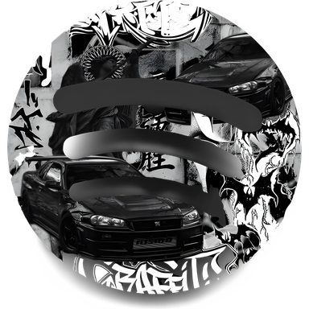

# Xtify

**A clean, ad-free music player for Androids & Windows. Search any song, play it, keep your favourites offline.**

[Download](../../releases/) · [Install](#install) · [How it works](#how-it-works)

</div>

---

## Screenshots

. Android
| Home | Search | Player |
| :---: | :---: | :---: |
| 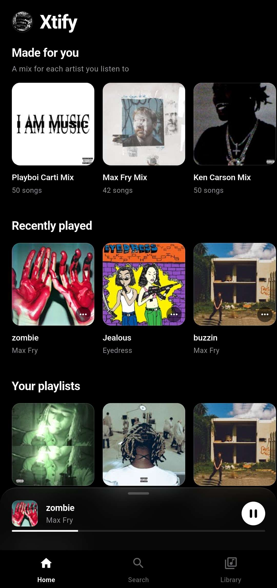 | 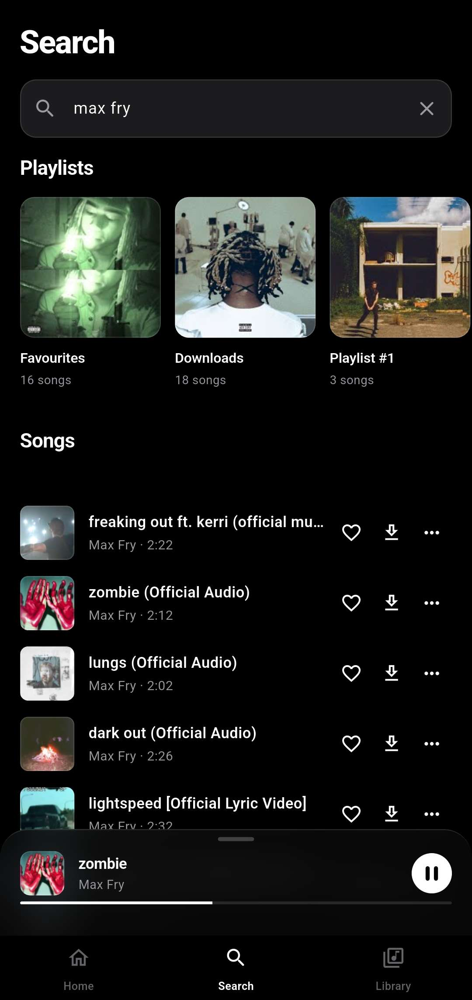 | 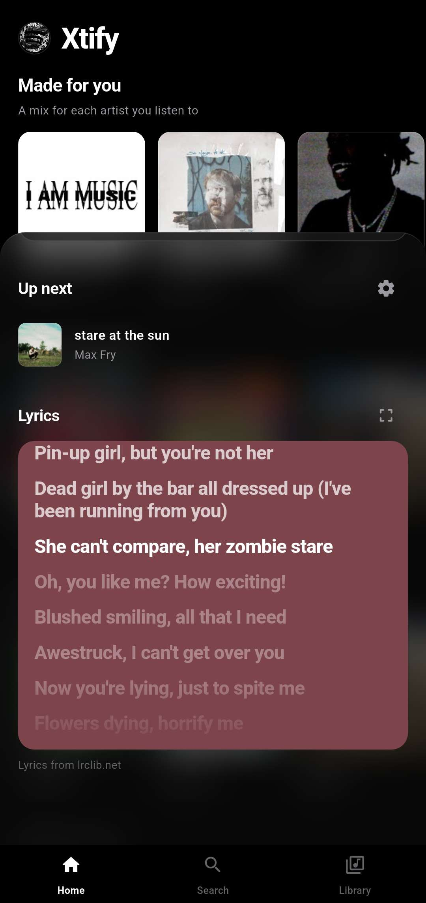 |

| Library | Downloads | Playlist |
| :---: | :---: | :---: |
| 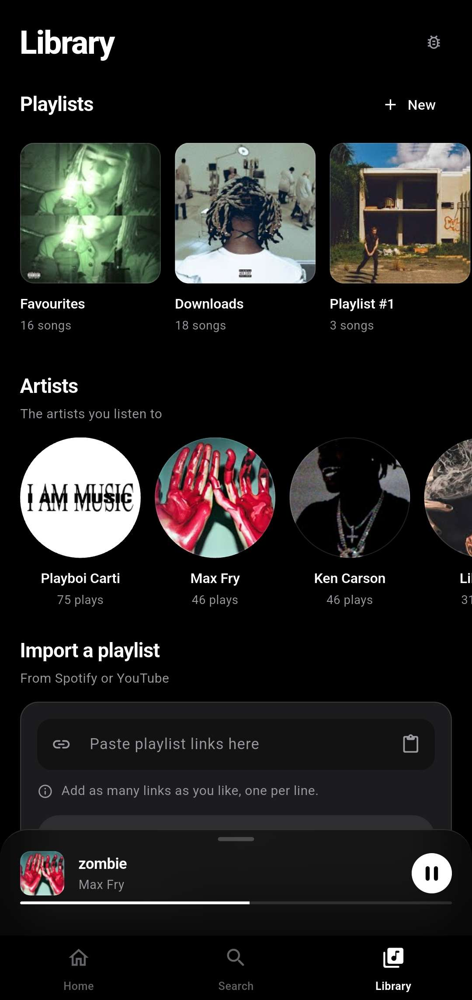 | 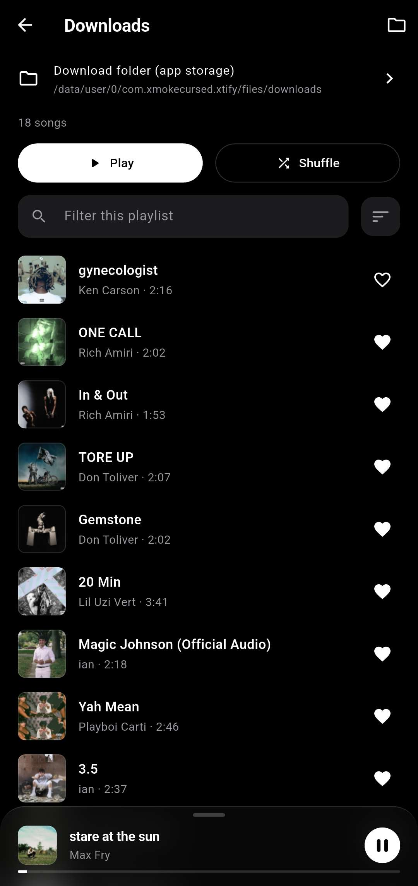 | 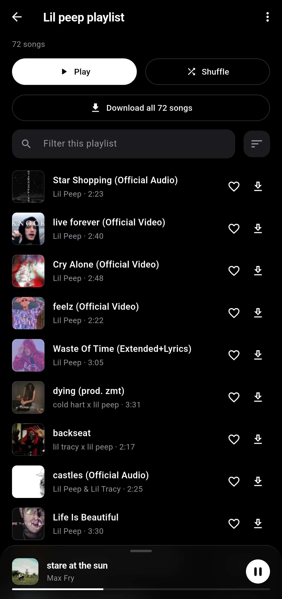 |

. Windows
| Home | Search | Player |
| :---: | :---: | :---: |
| 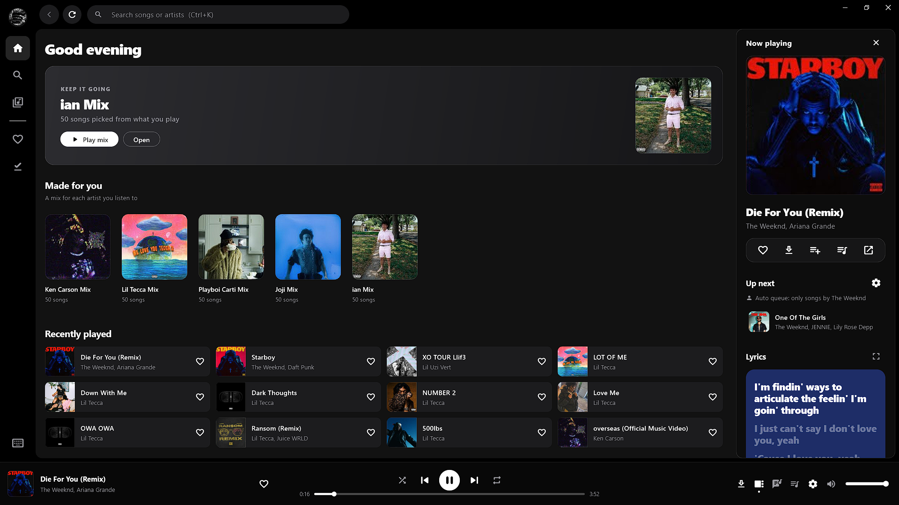 | 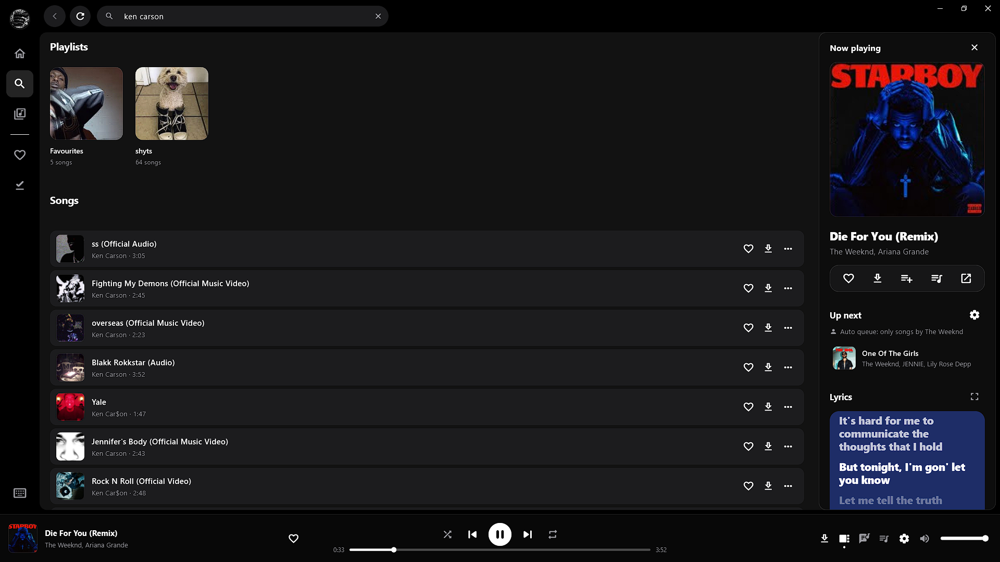 | 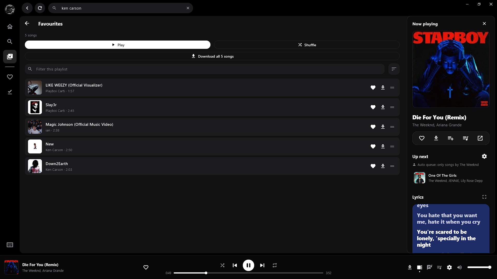 |

| Library | Downloads | Playlist |
| :---: | :---: | :---: |
| 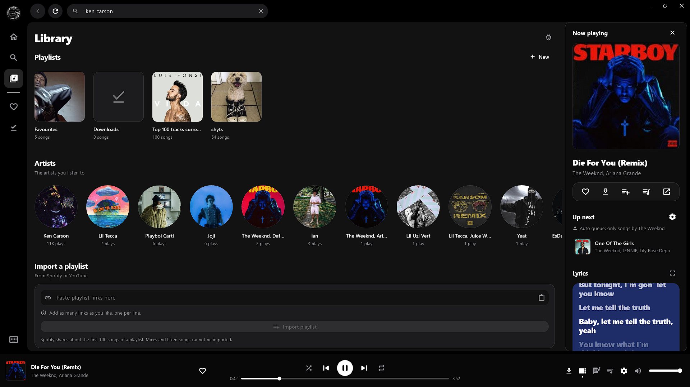 | 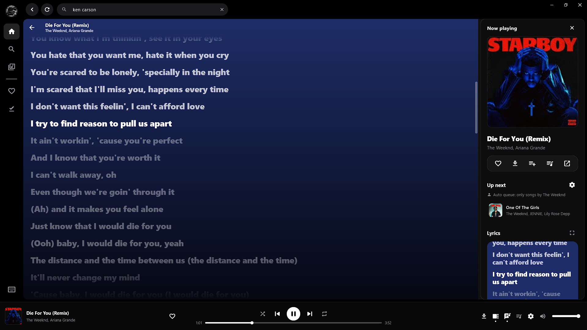 | 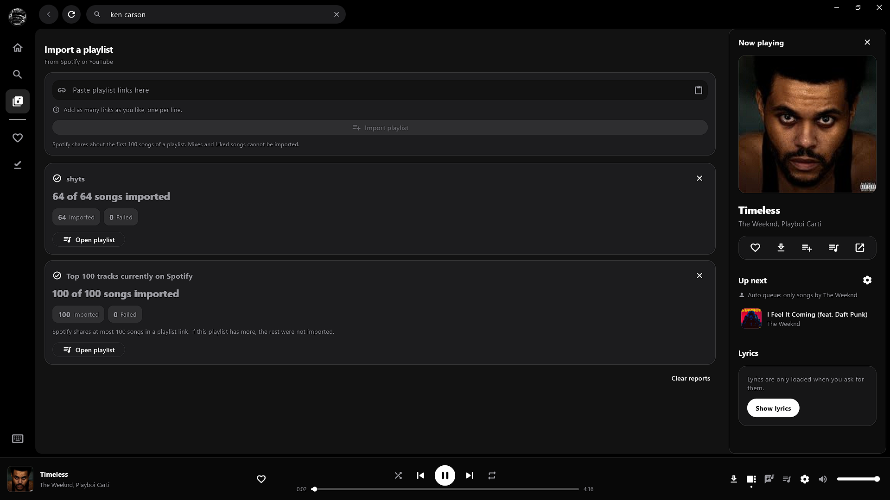 |

---

## Features

**Listen**
- Search songs and artists and play them. The first song after opening the app can take a bit longer to start.
- **Auto-queue:** when a song ends, Xtify picks the next one. Use the gear next to *Up next* to choose **similar songs** or **same artist only**.
- **Made for you:** a mix for each artist you listen to.
- Play next, add to queue, reorder, shuffle and repeat.
- Background play, with lock-screen and notification controls.
- Remembers the last song and where you stopped.
- Mostly Spotify/YTMusic premium experience.

**Keep**
- **Playlists and Favourites**, with modern sorting and a filtering options.
- **Import playlists** from Spotify and YouTube links into playlists of their own. Import as many as you like: a progress bar shows how far each one is, and a report afterwards says how many songs were imported and which ones failed and why. It lives in the Library, under Artists.
- **Download a whole playlist** with one button.
- **Downloads** with title, artist and cover art written into the file.
- **Offline mode:** with no internet, only your downloads show and play.
- History upto last 30 songs.

**Everyday**
- No ads.
- No subscription bs.
- Only songs.

---

## Install

1. Download `xtify-*.apk` or `XtifySetup.*` from the [Releases page](../../releases/).
2. Open it on your phone and allow installs from your browser or file manager if asked.

Signing in to YouTube is optional (see below).

### Build it yourself

Needs [Flutter](https://docs.flutter.dev/get-started/install) (Dart 3.13+) and the Android SDK.

```bash
git clone https://github.com/xmokecursed/xtify.git
cd xtify
flutter pub get
flutter run
```

There is no server to set up. Search, recommendations and playlist import all run inside the app.

---

## YouTube sign-in (optional)

Most songs play without it. YouTube sometimes refuses requests that don't look signed in (*"Sign in to confirm you're not a bot"*), and signing in fixes that.

- You log in on a normal Google page inside the app. Xtify NEVER sees your password.
- Only the session cookies are kept, encrypted, in the app's private storage on your phone. They are only ever sent to YouTube.
- If the login expires, a *Sign in again* notice will appear again.
- Tip: use a secondary Google account. Automated-looking use can, *rarely, get an account flagged.

---

## Privacy and security

Xtify has no account and no server of its own. What it knows about you stays on your device.

- Your playlists, favourites, history, searches, settings, sign-in cookies and the log of what the app did are stored encrypted. The key is kept by the system: in the Android Keystore on Android, and tied to your Windows account on Windows. Other programs that open Xtify's files only see scrambled data.
- This protects the files from other programs and from anyone who copies them. It cannot stop malware that fully controls your device while you are signed in, because such malware can ask the system for the key in the same way Xtify does.
- Downloaded songs and their cover art are normal audio and image files you can play anywhere, so they are not encrypted.
- Lyrics are public text from lrclib. They are cached as plain files named after the song's ID, so they are not encrypted. The short crash note Android writes when the app crashes (the error and its stack) is plain text too.
- Android's cloud backup is off for Xtify, so nothing from the app is uploaded to a backup.
- If Xtify cannot unlock its saved data, it never deletes, resets or replaces anything by itself. It tells you, keeps everything untouched and tries again at the next start. Starting over is only offered when the system says the key is gone, and only after you confirm.

---

## Xtify vs Spotify & YouTube Music

**Gains:** free and ad-free, background play and downloads without Premium, no clutter, and all your data stays on your phone as normal tagged audio files.

**Trade-offs:**
- Not an official app. It relies on YouTube, so songs can stop playing until the app is updated after a YouTube change. It goes against YouTube's Terms of Service; use it at your own risk.
- Sound quality is whatever YouTube provides.
- No lyrics, podcasts, sharing or Chromecast. The catalogue is YouTube's, so a song may come as a different version (live, remix) than you expected.
- Android Version 12+ only (the release APK targets 64-bit ARM). No cloud sync.
- Might add support for older versions of Android if i figure out how to.

---

## How it works

[](https://gitdiagram.com/xmokecursed/xtify?utm_source=readme&utm_medium=picture)

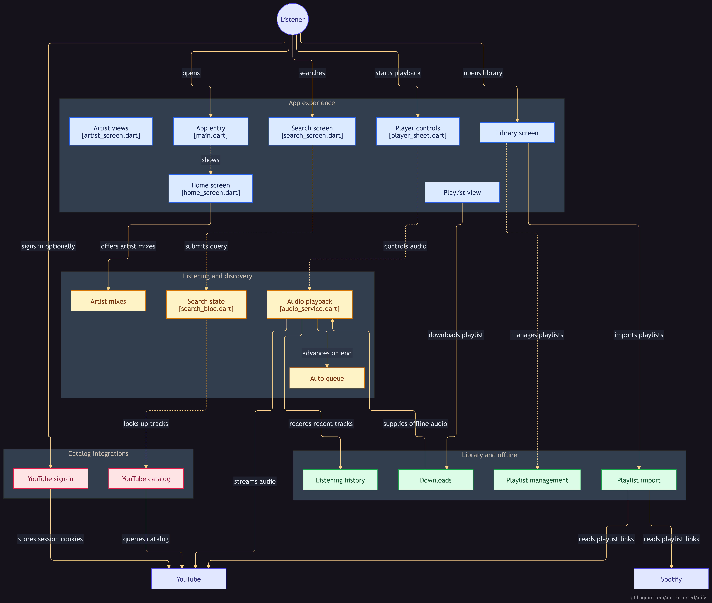

---

## Troubleshooting

| Problem | Try |
| --- | --- |
| Songs not playing, or "not a bot" error | Sign in (or sign in again) from the strip above the player. |
| Some songs failed to import | The report under *Library → Import a playlist* lists every failed song and why. Songs with no match on YouTube Music, and private or deleted videos, cannot be imported. |
| A Spotify playlist stopped after about 100 songs | Spotify only shares about the first 100 songs of a playlist link. The report says how many were left out. |
| Download fails | Check you're online and the download folder still exists. Downloading many songs quickly can get your IP temporarily flagged by YouTube. |
| A "Saved data is locked" notice at the top, and playlists or history are missing | Nothing was deleted. Close Xtify and open it again, it tries again at every start. If the notice says the key is gone (after a Windows password reset or reinstall, a reset of the phone's key storage, or when Xtify was opened as a different Windows user), tap *Details → Start fresh* to begin with an empty library. The old files are kept in a separate folder. |
| Something else is broken | Library → bug icon → *Copy debug info*, and send it with your report. |

---

## Disclaimer

Xtify is an independent personal project, not affiliated with YouTube, Google or Spotify. It hosts no music. You are responsible for how you use it. Please support the artists you love.

## Creator

[Xmoke](https://xmoke.is-a.dev)
