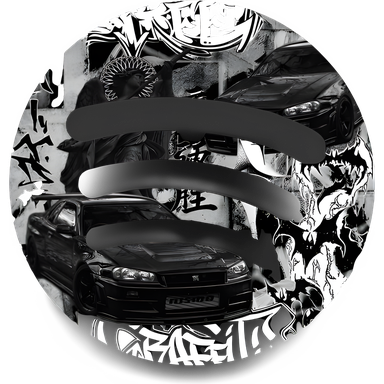

<div align="center">



# Xtify

**A clean, ad-free music player for Android. Search any song, play it instantly, and keep your favourites offline.**

[Download the APK](../../releases/latest) · [How it works](#how-it-works) · [Build it yourself](#build-it-yourself)

</div>

---

## Screenshots

> Add your screenshots to `docs/screenshots/` and they will show up here.

| Home | Search | Player |
| :---: | :---: | :---: |
|  |  |  |

| Library | Downloads | Queue |
| :---: | :---: | :---: |
|  |  |  |

---

## What it can do

**Listen**
- Search songs and artists and start playing in seconds.
- **Auto-queue:** when your song ends, Xtify picks a similar one so the music never stops.
- **Made for you:** a mix for each artist you listen to.
- Play next, add to queue, reorder the queue, shuffle and repeat (off / all / one).
- Plays in the background, with controls on the lock screen and notification.
- Remembers the last song and where you stopped.

**Keep**
- **Playlists and Favourites** with sort (recently added, title, artist) and a filter box.
- **Downloads:** save songs on your phone with the title, artist and cover art written into the file, so other music apps show them properly. Pick any download folder.
- **Offline mode:** with no internet, Xtify shows only what you downloaded and plays it with covers.
- History, with a way to remove single songs. Undo is one tap away.

**Everyday comfort**
- Black and white design, smooth animations, no ads and no banners.
- Open the original YouTube video of any song.
- A "Sign in again" notice when your login expires.
- **Copy debug info** button in the Library tab, for easy bug reports.

---

## Why a Google sign-in?

Xtify gets its songs from YouTube. YouTube often refuses requests that do not look like a real signed-in person and answers with *"Sign in to confirm you're not a bot"*. Signing in once inside the app solves that.

- The login happens in a normal Google page inside the app. Xtify never sees your password.
- Xtify keeps only the session cookies, in its own private storage on your phone.
- The cookies are used on your phone to ask YouTube for the audio. They are not sent to Xtify's server. The server only handles searches and recommendations.
- Signing out in the app deletes them.
- **Tip:** use a secondary Google account if you can. Automated-looking use of YouTube can, in rare cases, get an account flagged.

---

## Xtify vs Spotify and YouTube Music

**What you gain**
- **Free and ad-free**, with no Premium subscription needed.
- **Background play and downloads without paying.** These are Premium-only features in the official apps.
- A simple interface with nothing pushed at you.
- Your data stays on your phone: history, playlists and downloads are stored locally.
- Downloaded files are normal audio files with tags and cover art. You own them.

**What you give up. Please read this.**
- **It is not an official app.** It relies on YouTube's public pages. If YouTube changes something, songs can stop playing until the app's extractor is updated. Playback is sometimes slower to start than in the official apps.
- **It may go against YouTube's Terms of Service.** It is a private, personal project. Use it at your own risk.
- **Sound quality** is whatever YouTube provides, which is good but usually lower than Spotify's top setting.
- **No lyrics, no podcasts, no sharing, no social features and no Chromecast.**
- **Song catalogue is YouTube's.** Some songs have several versions (live, remix, lyric video), and the app can pick a different one than you expected.
- **The server sleeps.** Search and recommendations use a free server that falls asleep when unused. The first request after a pause can take 30 to 60 seconds.
- **Android only**, and the release APK is built for 64-bit ARM phones (almost every phone from the last several years).
- **No cloud sync.** Uninstalling the app removes your playlists unless you back up its data.

If you want the most reliable experience and are happy to pay, the official apps are the safer choice. Xtify is for people who want a free, simple, offline-friendly player and accept the trade-offs.

---

## Install

### Just want the app? Download the APK

1. Open the [**Releases** page](../../releases/latest) and download the latest `app-release.apk`.
2. Open the file on your phone. If Android asks, allow *Install unknown apps* for your browser or file manager.
3. Open Xtify, tap the *Sign in* button at the bottom, and log in with your Google account.
4. Search for a song and play it.

### Build it yourself

You need [Flutter](https://docs.flutter.dev/get-started/install) (Dart 3.13 or newer), the Android SDK and a phone or emulator.

```bash
git clone https://github.com/xmokecursed/xtify.git
cd xtify
flutter pub get
flutter run --release
```

To make an APK:

```bash
flutter build apk --release
```

The file is at `build/app/outputs/flutter-apk/app-release.apk`.

**Server.** Xtify talks to a small search and recommendations server ([xtify-backend](https://github.com/xmokecursed/xtify-backend)). The app points to a shared one by default. To run your own, deploy the backend and change `_baseUrl` in `lib/services/api_service.dart`.

---

## How it works

```
Phone (Xtify app) ──search / recommendations──▶ Xtify server ──▶ Last.fm + YouTube Music
        │
        └──audio link (your Google cookies, on the phone only)──▶ YouTube
```

- The app is written in Flutter. A yt-dlp runtime inside the app finds the audio stream for each song.
- Recommendations come from Last.fm and YouTube Music's "up next" data.
- Playback uses `just_audio` and `audio_service`, which gives lock-screen controls and background play.

---

## Troubleshooting

| Problem | What to try |
| --- | --- |
| "Sign in to confirm you're not a bot" or songs not playing | Tap the *Sign in again* notice and log in again. |
| First search is very slow | The server was asleep. Wait a minute and try again. |
| Download fails | Check that you are online and that the download folder still exists (change it from Downloads → folder icon). |
| Something is broken | Library tab → bug icon → *Copy debug info*, then send it with your report. |

---

## Disclaimer

Xtify is an independent personal project and is not affiliated with YouTube, Google, Spotify or Last.fm. It does not host any music. You are responsible for how you use it and for following the rules of the services it connects to. Please support the artists you love.
